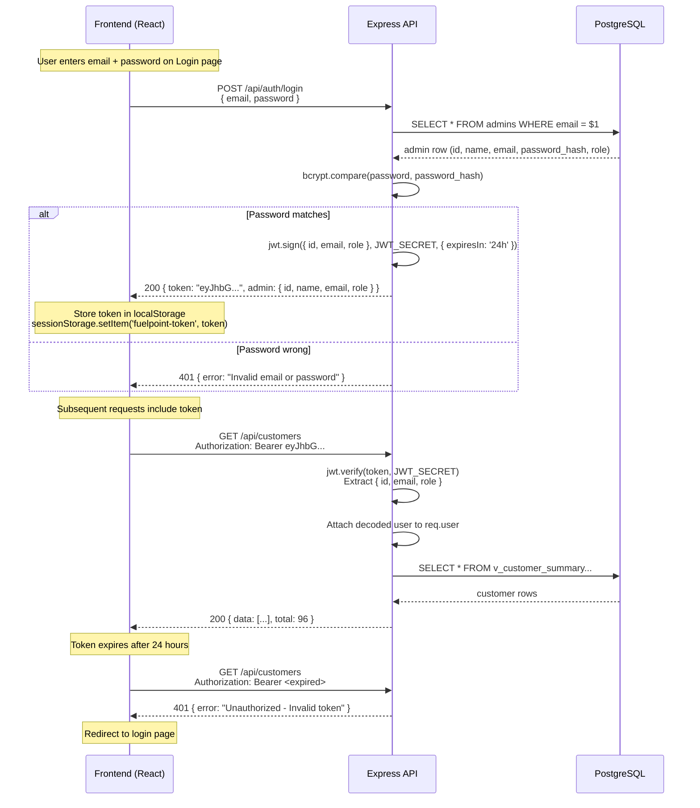
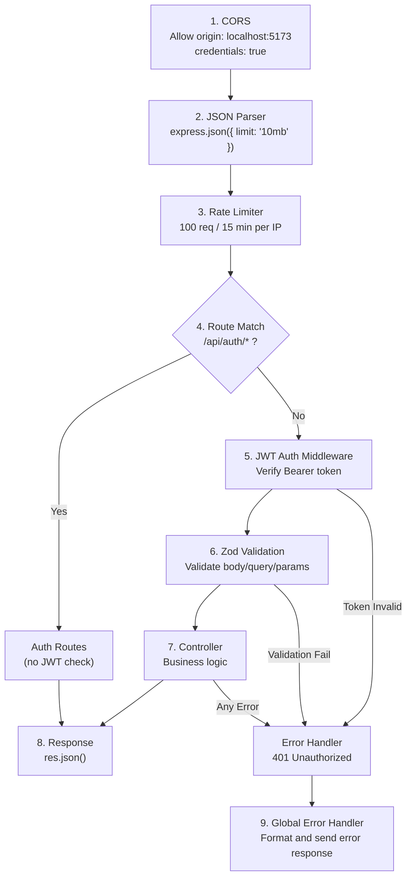
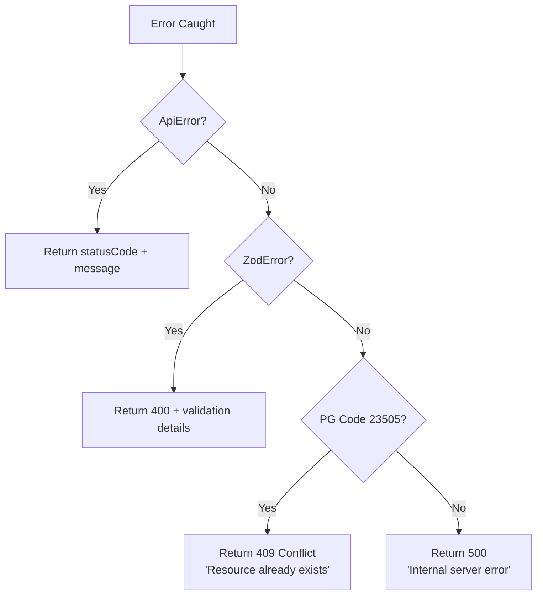

# FuelPoint — Node.js + Express Backend Documentation

> Complete implementation guide for the FuelPoint Admin Console REST API with JWT authentication, PostgreSQL, and Express.js.

---

## 1. Architecture Overview

```mermaid
graph LR
    subgraph Frontend["React Frontend (port 5173)"]
        A["adminService.ts"] -->|fetch()| B["Authorization: Bearer JWT"]
    end
    subgraph Backend["Express API (port 4000)"]
        B --> C["CORS Middleware"]
        C --> D["Rate Limiter"]
        D --> E["JSON Parser"]
        E --> F{"/api/auth/*?"}
        F -->|Yes| G["Auth Controller (no JWT check)"]
        F -->|No| H["JWT Auth Middleware"]
        H --> I["Route Handler"]
        I --> J["Controller"]
        J --> K["Service"]
        K --> L["pg Pool → PostgreSQL"]
    end
    subgraph Database["PostgreSQL (port 5432)"]
        L --> M["fuelpoint_db"]
    end
```

### Request Lifecycle

```
Client Request
  → CORS check
  → Rate limiter (100 req / 15 min)
  → JSON body parser (10 MB limit)
  → Route matching (/api/*)
  → JWT verification (skip for /api/auth/*)
  → Zod request validation
  → Controller logic
  → Service layer (SQL queries via pg pool)
  → JSON response
  → Error handler (catches all uncaught errors)
```

---

## 2. Technology Stack

| Layer | Package | Version | Purpose |
|---|---|---|---|
| **Runtime** | Node.js | ≥ 18 | JavaScript runtime |
| **Framework** | Express.js | ^4.21.0 | HTTP routing, middleware pipeline |
| **Language** | TypeScript | ^5.8.3 | Static type safety |
| **Database Driver** | pg (node-postgres) | ^8.13.0 | PostgreSQL connection pool, raw SQL queries |
| **Authentication** | jsonwebtoken | ^9.0.2 | JWT sign / verify |
| **Password Hashing** | bcrypt | ^5.1.1 | Salted hash for passwords |
| **Validation** | zod | ^3.25.76 | Request body / query / params schema validation |
| **Rate Limiting** | express-rate-limit | ^7.4.0 | Brute-force protection |
| **CORS** | cors | ^2.8.5 | Cross-origin requests from frontend |
| **Env Config** | dotenv | ^16.4.5 | Load `.env` variables |
| **Dev Runner** | tsx | ^4.19.0 | Execute TypeScript directly with hot-reload |

---

## 3. Project Structure

```
fuelpoint-api/
├── .env                              # Local environment variables
├── .env.example                      # Template (committed to git)
├── package.json                      # Dependencies and scripts
├── tsconfig.json                     # TypeScript configuration
│
├── sql/                              # Database migration files (run in order)
│   ├── 001_create_enums.sql          # Custom PostgreSQL ENUM types
│   ├── 002_create_tables.sql         # All 7 tables with constraints, indexes
│   ├── 003_create_views.sql          # Computed views (customer summary, worker summary, etc.)
│   ├── 004_create_triggers.sql       # Auto-update timestamps, auto-create notifications
│   └── 005_seed_data.sql             # Initial data (admin user, groups, workers)
│
├── scripts/
│   ├── migrate.ts                    # Runs 001–004 SQL files against the database
│   └── seed.ts                       # Runs 005 seed data SQL
│
└── src/
    ├── index.ts                      # Entry point — starts Express server
    ├── app.ts                        # Express app — middleware pipeline & route mounting
    │
    ├── config/
    │   ├── env.ts                    # Zod-validated environment variables
    │   └── database.ts               # pg Pool configuration and query helper
    │
    ├── middleware/
    │   ├── auth.ts                   # JWT verification — extracts user from Bearer token
    │   ├── validate.ts               # Zod schema validation for req.body/query/params
    │   ├── errorHandler.ts           # Global error handler (ApiError, ZodError, PG errors)
    │   └── rateLimiter.ts            # 100 requests per 15 minutes per IP
    │
    ├── routes/
    │   ├── index.ts                  # Route aggregator — mounts all sub-routers
    │   ├── auth.routes.ts            # POST /api/auth/login
    │   ├── admin.routes.ts           # GET/PUT /api/admin/profile, PUT /api/admin/password
    │   ├── customers.routes.ts       # CRUD /api/customers
    │   ├── workers.routes.ts         # CRUD /api/workers
    │   ├── groups.routes.ts          # CRUD /api/groups
    │   ├── transactions.routes.ts    # GET/POST /api/transactions
    │   ├── notifications.routes.ts   # GET/PATCH /api/notifications
    │   ├── dashboard.routes.ts       # GET /api/dashboard/*
    │   └── reports.routes.ts         # GET /api/reports/*
    │
    ├── controllers/
    │   ├── auth.controller.ts        # Login logic — bcrypt compare, JWT sign
    │   ├── admin.controller.ts       # Profile read/update, password change
    │   ├── customers.controller.ts   # Customer CRUD + group assignment
    │   ├── workers.controller.ts     # Worker CRUD + status toggle
    │   ├── groups.controller.ts      # Group CRUD + activate/deactivate
    │   ├── transactions.controller.ts # Transaction listing + creation
    │   ├── notifications.controller.ts # List, mark read, mark all read
    │   ├── dashboard.controller.ts   # Overview stats, time-series, distribution
    │   └── reports.controller.ts     # Date-range filtered reports + CSV export
    │
    ├── schemas/
    │   ├── auth.schema.ts            # Login request validation
    │   ├── customer.schema.ts        # Create/update customer validation
    │   ├── worker.schema.ts          # Create/update worker validation
    │   ├── group.schema.ts           # Create/update group validation
    │   └── notification.schema.ts    # Mark-read request validation
    │
    ├── utils/
    │   ├── ApiError.ts               # Custom error class with HTTP status code
    │   └── asyncHandler.ts           # Wraps async route handlers to catch errors
    │
    └── types/
        └── express.d.ts              # Extends Express Request with `user` property
```

---

## 4. Environment Variables

File: [`fuelpoint-api/.env`](file:///d:/Ran_project/FuelStationAdmin/fuelpoint-api/.env)

```env
# ── Database ──
DB_HOST=localhost          # pgAdmin host
DB_PORT=5432               # PostgreSQL default port
DB_NAME=fuelpoint_db       # Database name (create in pgAdmin first)
DB_USER=postgres           # Your pgAdmin username
DB_PASSWORD=admin          # Your pgAdmin password

# ── Server ──
PORT=4000                  # Express server port
NODE_ENV=development

# ── Authentication ──
JWT_SECRET=your-super-secret-jwt-key-change-in-production
JWT_EXPIRES_IN=24h         # Token expiry (24 hours)

# ── CORS ──
CORS_ORIGIN=http://localhost:5173   # Frontend URL
```

> [!CAUTION]
> Never commit `.env` to git. The `.env.example` file is the template.

All variables are validated at startup using Zod in [`env.ts`](file:///d:/Ran_project/FuelStationAdmin/fuelpoint-api/src/config/env.ts). If any required variable is missing, the server exits immediately with a clear error message.

---

## 5. JWT Authentication Flow

### 5.1 How It Works



### 5.2 Token Payload Structure

```json
{
  "id": "a1b2c3d4-e5f6-7890-abcd-ef1234567890",
  "email": "rajesh.menon@fuelpoint.in",
  "role": "super_admin",
  "iat": 1727696400,
  "exp": 1727782800
}
```

### 5.3 Auth Middleware Logic

File: [`middleware/auth.ts`](file:///d:/Ran_project/FuelStationAdmin/fuelpoint-api/src/middleware/auth.ts)

```
1. Extract Authorization header
2. Check it starts with "Bearer "
3. Extract the token string
4. jwt.verify(token, JWT_SECRET)
5. If valid → attach decoded payload to req.user → call next()
6. If invalid/expired → throw ApiError(401)
```

### 5.4 Which Routes Are Protected?

| Route Prefix | Auth Required | Why |
|---|---|---|
| `POST /api/auth/login` | ❌ No | User hasn't logged in yet |
| `GET /api/admin/*` | ✅ Yes | Admin profile operations |
| `GET/POST/PUT/DELETE /api/customers/*` | ✅ Yes | Customer management |
| `GET/POST/PUT/DELETE /api/workers/*` | ✅ Yes | Worker management |
| `GET/POST/PUT/DELETE /api/groups/*` | ✅ Yes | Group management |
| `GET/POST /api/transactions/*` | ✅ Yes | Transaction data |
| `GET/PATCH /api/notifications/*` | ✅ Yes | Notification management |
| `GET /api/dashboard/*` | ✅ Yes | Analytics data |
| `GET /api/reports/*` | ✅ Yes | Report data |
| `GET /health` | ❌ No | Health check for monitoring |

---

## 6. Middleware Pipeline

Execution order in [`app.ts`](file:///d:/Ran_project/FuelStationAdmin/fuelpoint-api/src/app.ts):



---

## 7. Complete API Endpoints

### 7.1 Authentication

#### `POST /api/auth/login`

Login and receive a JWT token.

**Request Body:**
```json
{
  "email": "rajesh.menon@fuelpoint.in",
  "password": "fuelpoint"
}
```

**Success Response (200):**
```json
{
  "token": "eyJhbGciOiJIUzI1NiIsInR5cCI6IkpXVCJ9...",
  "admin": {
    "id": "uuid",
    "name": "Rajesh Menon",
    "email": "rajesh.menon@fuelpoint.in",
    "role": "super_admin",
    "location": "Pune, Maharashtra"
  }
}
```

**Error Response (401):**
```json
{ "error": "Invalid email or password" }
```

---

### 7.2 Admin Profile

> All endpoints below require `Authorization: Bearer <token>` header.

#### `GET /api/admin/profile`

Get the logged-in admin's profile.

**Response (200):**
```json
{
  "id": "uuid",
  "name": "Rajesh Menon",
  "email": "rajesh.menon@fuelpoint.in",
  "phone": "+91 98204 41120",
  "role": "super_admin",
  "location": "Pune, Maharashtra",
  "joinedAt": "2024-10-03T09:15:00.000Z",
  "initials": "RM"
}
```

#### `PUT /api/admin/profile`

Update admin profile fields.

**Request Body:**
```json
{
  "name": "Rajesh Menon",
  "phone": "+91 98204 41120",
  "location": "Mumbai, Maharashtra"
}
```

#### `PUT /api/admin/password`

Change admin password.

**Request Body:**
```json
{
  "currentPassword": "fuelpoint",
  "newPassword": "newSecurePass123"
}
```

---

### 7.3 Customers

#### `GET /api/customers`

List customers with pagination, search, and filters.

**Query Parameters:**

| Param | Type | Default | Description |
|---|---|---|---|
| `page` | number | 1 | Page number |
| `limit` | number | 20 | Items per page |
| `search` | string | — | Search in name, phone, email |
| `group_id` | UUID | — | Filter by group |
| `status` | string | — | `active`, `inactive`, or `pending` |
| `sort` | string | `registered_at` | Sort column |
| `order` | string | `desc` | `asc` or `desc` |

**Response (200):**
```json
{
  "data": [
    {
      "id": "uuid",
      "name": "Aarav Sharma",
      "phone": "+91 8123456789",
      "email": "aarav.sharma0@mail.com",
      "vehicle": "Maruti Swift",
      "group_id": "uuid",
      "group_name": "Family",
      "group_discount": 2.00,
      "status": "active",
      "registered_at": "2026-01-15T10:30:00.000Z",
      "last_activity": "2026-09-20T14:15:00.000Z",
      "transactions": 42,
      "total_spend": 84000,
      "discount_received": 1680
    }
  ],
  "total": 96,
  "page": 1,
  "limit": 20,
  "totalPages": 5
}
```

#### `GET /api/customers/:id`

Get a single customer with computed stats (from `v_customer_summary` view).

#### `POST /api/customers`

Create a new customer.

**Request Body:**
```json
{
  "name": "Priya Reddy",
  "phone": "+91 8999888777",
  "email": "priya.reddy@mail.com",
  "vehicle": "Honda City",
  "group_id": "uuid-of-default-group",
  "password": "optional_password"
}
```

> [!NOTE]
> If `group_id` is the default group, a **notification is automatically created** by the PostgreSQL trigger: *"New customer registration — group assignment required."*

#### `PUT /api/customers/:id`

Update customer details.

**Request Body:**
```json
{
  "name": "Priya Reddy",
  "phone": "+91 8999888777",
  "email": "priya.updated@mail.com",
  "vehicle": "Hyundai Creta",
  "status": "active"
}
```

#### `PATCH /api/customers/:id/group`

Assign customer to a different discount group.

**Request Body:**
```json
{
  "group_id": "uuid-of-family-group"
}
```

**Business Logic:**
1. Update `customers.group_id`
2. If moving out of default group and customer has transactions → set status to `active`
3. Mark any pending registration notification for this customer as `read`

#### `DELETE /api/customers/:id`

Delete a customer. All their transactions are also deleted (CASCADE).

#### `GET /api/customers/:id/transactions`

Get all transactions for a specific customer.

---

### 7.4 Workers

#### `GET /api/workers`

List all workers with computed stats (from `v_worker_summary` view).

**Query Parameters:** `page`, `limit`, `search`, `status`, `shift`, `sort`, `order`

**Response (200):**
```json
{
  "data": [
    {
      "id": "uuid",
      "name": "Suresh Kumar",
      "email": "suresh.kumar@fuelpoint.in",
      "phone": "+91 9123456780",
      "shift": "Morning",
      "status": "active",
      "joined_at": "2025-05-18T09:15:00.000Z",
      "last_activity": "2026-09-23T10:00:00.000Z",
      "scans": 850,
      "customers_scanned": 340,
      "transactions": 780,
      "discount_processed": 15600
    }
  ],
  "total": 10,
  "page": 1,
  "limit": 20,
  "totalPages": 1
}
```

#### `GET /api/workers/:id`
#### `POST /api/workers`

**Request Body:**
```json
{
  "name": "New Worker",
  "email": "new.worker@fuelpoint.in",
  "phone": "+91 9000000001",
  "shift": "Morning",
  "password": "securePass"
}
```

#### `PUT /api/workers/:id`
#### `PATCH /api/workers/:id/status`

**Request Body:**
```json
{ "status": "suspended" }
```

#### `DELETE /api/workers/:id`
#### `GET /api/workers/:id/transactions`

---

### 7.5 Discount Groups

#### `GET /api/groups`

List all groups with customer count and total discount generated (from `v_group_distribution` view).

**Response (200):**
```json
{
  "data": [
    {
      "id": "uuid",
      "name": "Family",
      "discount_percent": 2.00,
      "is_active": true,
      "is_default": false,
      "created_at": "2025-09-28T09:15:00.000Z",
      "customer_count": 25,
      "total_discount_generated": 48500,
      "transaction_count": 120
    }
  ]
}
```

#### `GET /api/groups/:id`
#### `POST /api/groups`

**Request Body:**
```json
{
  "name": "VIP Customers",
  "discount_percent": 5.00,
  "description": "Premium loyalty customers"
}
```

#### `PUT /api/groups/:id`

**Request Body:**
```json
{
  "name": "VIP Customers",
  "discount_percent": 4.50,
  "description": "Updated description"
}
```

> [!WARNING]
> The **Default / Customer** group (`is_default = true`) cannot be deleted or deactivated. The API must reject such requests with `400 Bad Request`.

#### `PATCH /api/groups/:id/toggle`

Toggle `is_active` on/off. No request body needed.

#### `DELETE /api/groups/:id`

Delete a group. All customers in this group are **moved to the Default group** (handled by `ON DELETE SET DEFAULT` in PostgreSQL).

#### `GET /api/groups/:id/customers`

List all customers in a specific group.

---

### 7.6 Transactions

#### `GET /api/transactions`

**Query Parameters:** `page`, `limit`, `customer_id`, `worker_id`, `fuel`, `from` (date), `to` (date), `sort`, `order`

**Response (200):**
```json
{
  "data": [
    {
      "id": "uuid",
      "customer_id": "uuid",
      "customer_name": "Aarav Sharma",
      "worker_id": "uuid",
      "worker_name": "Suresh Kumar",
      "group_id": "uuid",
      "amount": 2400.00,
      "discount_percent": 2.00,
      "discount_amount": 48.00,
      "litres": 23.1,
      "fuel": "Petrol",
      "created_at": "2026-09-22T14:30:00.000Z"
    }
  ],
  "total": 420,
  "page": 1,
  "limit": 20,
  "totalPages": 21
}
```

> [!NOTE]
> `customer_name` and `worker_name` are resolved via JOINs — **not stored** in the transactions table. This is the normalized approach vs. the mock data's denormalization.

#### `GET /api/transactions/:id`

#### `POST /api/transactions`

Create a new fuel transaction.

**Request Body:**
```json
{
  "customer_id": "uuid",
  "worker_id": "uuid",
  "amount": 2400.00,
  "litres": 23.1,
  "fuel": "Petrol"
}
```

**Server-side logic:**
1. Look up customer's `group_id` and the group's `discount_percent`
2. Calculate `discount_amount = amount × discount_percent / 100`
3. Store `discount_percent` as a snapshot (so changing the group later doesn't rewrite history)
4. Update `customers.last_activity` and `workers.last_activity` to `NOW()`

---

### 7.7 Notifications

#### `GET /api/notifications`

**Query Parameters:** `filter` (`all`, `unread`, `registration`, `group`, `worker`, `system`)

**Response (200):**
```json
{
  "data": [
    {
      "id": "uuid",
      "type": "registration",
      "title": "New customer registration — group assignment required",
      "message": "Priya Reddy (+91 8999888777) registered and is currently in Default / Unassigned.",
      "is_read": false,
      "customer_id": "uuid",
      "created_at": "2026-09-23T08:30:00.000Z"
    }
  ],
  "unread_count": 4
}
```

#### `GET /api/notifications/unread-count`

**Response:** `{ "count": 4 }`

#### `PATCH /api/notifications/:id/read`

Mark a single notification as read. Sets `is_read = true` and `read_at = NOW()`.

#### `PATCH /api/notifications/read-all`

Mark all notifications as read for the current admin.

---

### 7.8 Dashboard & Analytics

#### `GET /api/dashboard/overview`

Returns all stat-card values for the dashboard. Uses the `v_dashboard_overview` view.

**Response (200):**
```json
{
  "total_customers": 96,
  "total_workers": 10,
  "active_workers": 7,
  "total_groups": 5,
  "total_transactions": 420,
  "total_discount": 18500,
  "total_revenue": 850000,
  "today_transactions": 5,
  "today_discount": 220,
  "new_registrations_7d": 3,
  "active_customers": 72,
  "used_pump_customers": 88,
  "unassigned_customers": 12
}
```

#### `GET /api/dashboard/series?days=30`

Returns daily time-series data for charts (transactions, discount, registrations, revenue).

**Response (200):**
```json
{
  "data": [
    { "date": "2026-08-25", "label": "25 Aug", "transactions": 5, "discount": 230, "registrations": 1, "revenue": 12500 },
    { "date": "2026-08-26", "label": "26 Aug", "transactions": 8, "discount": 410, "registrations": 0, "revenue": 19200 }
  ]
}
```

#### `GET /api/dashboard/group-distribution`

Customer count per group (for donut chart).

#### `GET /api/dashboard/worker-activity`

Top workers by scan count (for bar chart).

---

### 7.9 Reports

#### `GET /api/reports/:type`

Where `:type` is one of: `customers`, `workers`, `transactions`, `discounts`, `groups`

**Query Parameters:**

| Param | Type | Default | Description |
|---|---|---|---|
| `range` | string | `month` | `today`, `week`, `month`, `quarter`, `custom` |
| `from` | string | — | Custom start date (YYYY-MM-DD) |
| `to` | string | — | Custom end date (YYYY-MM-DD) |
| `format` | string | `json` | `json` or `csv` |

**For `format=csv`:** Returns `Content-Type: text/csv` with `Content-Disposition: attachment; filename="..."` header for direct download.

---

## 8. Validation Schemas

Every mutating endpoint validates the request using Zod before the controller runs.

### Customer Schema
```typescript
// schemas/customer.schema.ts
const createCustomerSchema = z.object({
  body: z.object({
    name:     z.string().min(2).max(120),
    phone:    z.string().min(10).max(20),
    email:    z.string().email(),
    vehicle:  z.string().max(100).optional(),
    group_id: z.string().uuid(),
    password: z.string().min(4).optional(),
  })
});

const updateCustomerSchema = z.object({
  params: z.object({ id: z.string().uuid() }),
  body: z.object({
    name:    z.string().min(2).max(120).optional(),
    phone:   z.string().min(10).max(20).optional(),
    email:   z.string().email().optional(),
    vehicle: z.string().max(100).optional(),
    status:  z.enum(['active', 'inactive', 'pending']).optional(),
  })
});

const assignGroupSchema = z.object({
  params: z.object({ id: z.string().uuid() }),
  body: z.object({ group_id: z.string().uuid() })
});
```

### Worker Schema
```typescript
// schemas/worker.schema.ts
const createWorkerSchema = z.object({
  body: z.object({
    name:     z.string().min(2).max(120),
    email:    z.string().email(),
    phone:    z.string().min(10).max(20),
    shift:    z.enum(['Morning', 'Evening', 'Night']),
    password: z.string().min(4).optional(),
  })
});
```

### Group Schema
```typescript
// schemas/group.schema.ts
const createGroupSchema = z.object({
  body: z.object({
    name:             z.string().min(2).max(100),
    discount_percent: z.number().min(0).max(100),
    description:      z.string().max(500).optional(),
  })
});
```

---

## 9. Error Handling Strategy

### Custom Error Class

```typescript
// utils/ApiError.ts
class ApiError extends Error {
    statusCode: number;
    constructor(statusCode: number, message: string) {
        super(message);
        this.statusCode = statusCode;
    }
}
```

### Error Response Format

All errors follow the same structure:

```json
{
  "error": "Human-readable error message",
  "details": []   // Optional — present only for Zod validation errors
}
```

### Error Handler Decision Tree



| Status Code | When |
|---|---|
| `200` | Successful read/update |
| `201` | Successful create |
| `204` | Successful delete (no content) |
| `400` | Zod validation failure, bad request |
| `401` | Missing/invalid/expired JWT |
| `404` | Resource not found |
| `409` | Duplicate unique constraint violation |
| `429` | Rate limit exceeded |
| `500` | Unexpected server error |

---

## 10. Standard Response Formats

### Success — Single Item
```json
{
  "data": { "id": "uuid", "name": "...", ... }
}
```

### Success — List with Pagination
```json
{
  "data": [ { ... }, { ... } ],
  "total": 96,
  "page": 1,
  "limit": 20,
  "totalPages": 5
}
```

### Success — Action Confirmation
```json
{
  "message": "Customer group updated successfully"
}
```

### Error
```json
{
  "error": "Invalid email or password"
}
```

---

## 11. Database Connection

File: [`config/database.ts`](file:///d:/Ran_project/FuelStationAdmin/fuelpoint-api/src/config/database.ts)

```typescript
const pool = new Pool({
    host:     env.DB_HOST,     // localhost
    port:     env.DB_PORT,     // 5432
    database: env.DB_NAME,     // fuelpoint_db
    user:     env.DB_USER,     // postgres
    password: env.DB_PASSWORD, // your pgAdmin password
    max:      20,              // Max simultaneous connections
    idleTimeoutMillis: 30000,  // Close idle connections after 30s
    connectionTimeoutMillis: 5000,  // Fail fast if can't connect in 5s
});
```

### Query Helper

All controllers use parameterized queries (`$1`, `$2`, ...) to prevent SQL injection:

```typescript
// Safe — parameterized
await query('SELECT * FROM customers WHERE email = $1', [email]);

// NEVER do this — SQL injection vulnerable
await query(`SELECT * FROM customers WHERE email = '${email}'`);
```

---

## 12. Frontend Integration Guide

### What Changes

Only **one file** in the frontend needs to change: [`adminService.ts`](file:///d:/Ran_project/FuelStationAdmin/src/services/adminService.ts)

### Before (Mock Data)
```typescript
export const adminService = {
  getCustomers: (): Customer[] => mockCustomers,
  getWorkers: (): Worker[] => mockWorkers,
  getGroups: (): Group[] => mockGroups,
};
```

### After (Real API)
```typescript
const API = 'http://localhost:4000/api';

const headers = () => ({
  'Content-Type': 'application/json',
  'Authorization': `Bearer ${sessionStorage.getItem('fuelpoint-token')}`,
});

export const adminService = {
  getCustomers: async (params?) => {
    const qs = new URLSearchParams(params).toString();
    const res = await fetch(`${API}/customers?${qs}`, { headers: headers() });
    return res.json();
  },

  getWorkers: async () => {
    const res = await fetch(`${API}/workers`, { headers: headers() });
    return res.json();
  },

  getGroups: async () => {
    const res = await fetch(`${API}/groups`, { headers: headers() });
    return res.json();
  },
};
```

### Login Flow Change

```typescript
// In the login page, after successful POST /api/auth/login:
const { token, admin } = await response.json();
sessionStorage.setItem('fuelpoint-token', token);
// Now all subsequent fetch() calls include the Bearer token
```

---

## 13. How to Run

### Prerequisites
- Node.js ≥ 18
- PostgreSQL (via pgAdmin) running locally
- Database `fuelpoint_db` created in pgAdmin

### Setup & Run

```bash
# 1. Navigate to the backend
cd fuelpoint-api

# 2. Install dependencies (already done)
npm install

# 3. Configure your database credentials in .env
#    Edit: DB_PASSWORD=your_pgadmin_password

# 4. Run database migrations (creates tables, views, triggers)
npm run migrate

# 5. Seed initial data (admin user, groups, workers)
npm run seed

# 6. Start the dev server (auto-restarts on file changes)
npm run dev
# → 🚀 API Server running on http://localhost:4000

# 7. Test the health endpoint
curl http://localhost:4000/health
# → { "status": "ok", "time": "2026-09-30T..." }

# 8. Test login
curl -X POST http://localhost:4000/api/auth/login \
  -H "Content-Type: application/json" \
  -d '{"email":"rajesh.menon@fuelpoint.in","password":"fuelpoint"}'
# → { "token": "eyJhbG...", "admin": { ... } }
```

### NPM Scripts

| Script | Command | Purpose |
|---|---|---|
| `npm run dev` | `tsx watch src/index.ts` | Start dev server with hot-reload |
| `npm run build` | `tsc` | Compile TypeScript to JavaScript |
| `npm start` | `node dist/index.js` | Run production build |
| `npm run migrate` | `tsx scripts/migrate.ts` | Run SQL migrations |
| `npm run seed` | `tsx scripts/seed.ts` | Insert seed data |

---

## 14. Security Summary

| Concern | Solution |
|---|---|
| **Password Storage** | bcrypt with 10 salt rounds — never plain text |
| **Authentication** | JWT with configurable expiry (default 24h) |
| **Authorization** | Every `/api/*` route (except `/api/auth/*`) requires valid Bearer token |
| **SQL Injection** | All queries use parameterized placeholders (`$1`, `$2`) |
| **Brute Force** | Rate limiter: 100 requests per 15 minutes per IP |
| **CORS** | Only `http://localhost:5173` (frontend) is allowed |
| **Input Validation** | Zod schemas validate all request bodies before processing |
| **Error Leaking** | Production errors return generic messages, not stack traces |
| **Audit Trail** | `audit_log` table records all admin actions with IP address |

---

## 15. Mapping: Frontend Operations → API Endpoints

This table maps every action in the frontend's [`admin-store.tsx`](file:///d:/Ran_project/FuelStationAdmin/src/lib/admin-store.tsx) to its corresponding API call:

| Frontend Operation | Store Method | API Endpoint | HTTP Method |
|---|---|---|---|
| Sign in | `login(email)` | `/api/auth/login` | `POST` |
| Sign out | `logout()` | Client-side only (clear token) | — |
| Get profile | `profile` | `/api/admin/profile` | `GET` |
| Update profile | `updateProfile(patch)` | `/api/admin/profile` | `PUT` |
| List customers | `customers` | `/api/customers` | `GET` |
| Create customer | `saveCustomer(customer)` | `/api/customers` | `POST` |
| Update customer | `saveCustomer(customer)` | `/api/customers/:id` | `PUT` |
| Delete customer | `deleteCustomer(id)` | `/api/customers/:id` | `DELETE` |
| Assign group | `assignCustomerGroup(id, groupId)` | `/api/customers/:id/group` | `PATCH` |
| List workers | `workers` | `/api/workers` | `GET` |
| Create worker | `saveWorker(worker)` | `/api/workers` | `POST` |
| Update worker | `saveWorker(worker)` | `/api/workers/:id` | `PUT` |
| Delete worker | `deleteWorker(id)` | `/api/workers/:id` | `DELETE` |
| List groups | `groups` | `/api/groups` | `GET` |
| Create group | `saveGroup(group)` | `/api/groups` | `POST` |
| Update group | `saveGroup(group)` | `/api/groups/:id` | `PUT` |
| Delete group | `deleteGroup(id)` | `/api/groups/:id` | `DELETE` |
| Toggle group active | `toggleGroupActive(id)` | `/api/groups/:id/toggle` | `PATCH` |
| List transactions | `transactions` | `/api/transactions` | `GET` |
| List notifications | `notifications` | `/api/notifications` | `GET` |
| Unread count | `unreadCount` | `/api/notifications/unread-count` | `GET` |
| Mark read | `markRead(id)` | `/api/notifications/:id/read` | `PATCH` |
| Mark all read | `markAllRead()` | `/api/notifications/read-all` | `PATCH` |
| Dashboard stats | Dashboard page | `/api/dashboard/overview` | `GET` |
| Dashboard charts | Dashboard page | `/api/dashboard/series?days=30` | `GET` |
| Group distribution | Dashboard page | `/api/dashboard/group-distribution` | `GET` |
| Worker activity | Dashboard page | `/api/dashboard/worker-activity` | `GET` |
| Reports | Reports page | `/api/reports/:type?range=month` | `GET` |
| CSV export | Reports page | `/api/reports/:type?format=csv` | `GET` |
