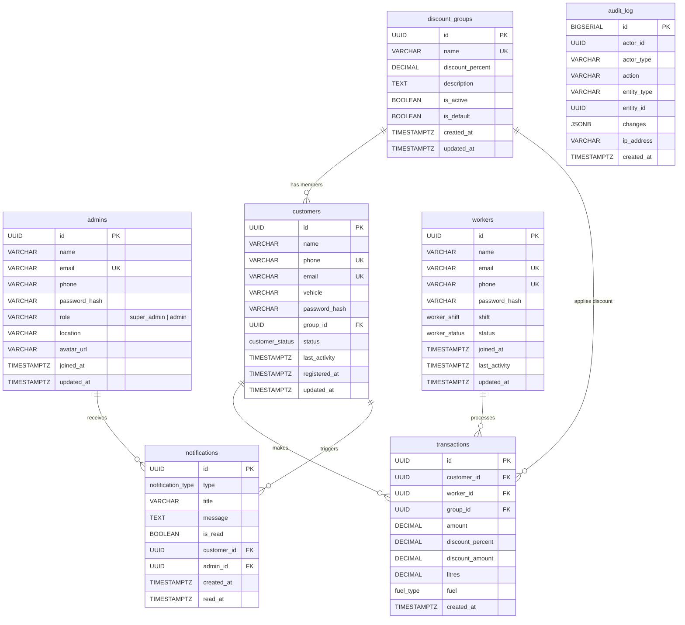
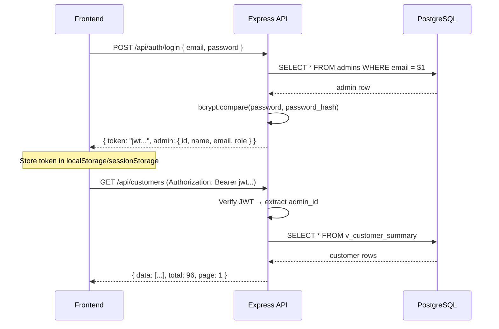

# FuelPoint — PostgreSQL Database Design & Node.js/Express Backend Plan

---

## 1. Overview

This document is the **complete implementation plan** to move the FuelPoint Admin Console from mock data to a real **PostgreSQL** database with a **Node.js + Express** backend API.

| Component | Technology |
|---|---|
| **Database** | PostgreSQL 16 (local pgAdmin) |
| **Backend** | Node.js + Express.js |
| **ORM / Query** | `pg` (node-postgres) — raw SQL for full control |
| **Auth** | JWT (jsonwebtoken) + bcrypt |
| **Validation** | Zod (same library the frontend already uses) |
| **Frontend** | Existing React app — only `adminService.ts` changes |

> [!IMPORTANT]
> **Database Name**: `fuelpoint_db`
> **Default Port**: `5432`
> **Backend Port**: `4000` (API server)
> **Frontend Port**: `5173` (Vite dev server)

---

## 2. Entity-Relationship Diagram



---

## 3. Database Design Decisions

### 3.1 Why This Design Differs from the Mock Data

| Mock Data Approach | Database Design | Reason |
|---|---|---|
| `customer.transactions` (counter) | Computed via `COUNT(*)` on transactions table | **Normalization** — never store derived data; always compute from the source of truth |
| `customer.totalSpend` (counter) | Computed via `SUM(amount)` on transactions table | Same — prevents data inconsistency |
| `customer.discountReceived` (counter) | Computed via `SUM(discount_amount)` on transactions table | Same |
| `worker.scans` (counter) | Computed via `COUNT(*)` on transactions table | Same |
| `worker.customersScanned` (counter) | Computed via `COUNT(DISTINCT customer_id)` | Same |
| `worker.discountProcessed` (counter) | Computed via `SUM(discount_amount)` | Same |
| `transaction.customerName` (denormalized) | `JOIN customers ON id` | **No denormalization** — get names via JOINs |
| `transaction.workerName` (denormalized) | `JOIN workers ON id` | Same |
| String IDs (`CUS-1000`, `WRK-001`) | `UUID` (auto-generated) | Industry standard, globally unique, no collision risk |

### 3.2 Key Principles

1. **UUIDs for all primary keys** — `gen_random_uuid()` (built-in PostgreSQL 13+)
2. **Passwords hashed with bcrypt** — never store plain text
3. **ENUMs for constrained values** — fuel type, status, shift, notification type
4. **Foreign keys with ON DELETE rules** — cascading deletes where appropriate, SET DEFAULT for group reassignment
5. **Timestamps as `TIMESTAMPTZ`** — timezone-aware, UTC storage
6. **Indexes on all foreign keys and frequently queried columns**
7. **Audit log** — track all admin actions for security compliance

---

## 4. Complete SQL Schema

### 4.1 Create Database & Connect

```sql
-- Run in pgAdmin Query Tool (connected to default 'postgres' database)
CREATE DATABASE fuelpoint_db
    WITH ENCODING = 'UTF8'
         LC_COLLATE = 'en_US.UTF-8'
         LC_CTYPE = 'en_US.UTF-8'
         TEMPLATE = template0;

-- Now connect to fuelpoint_db and run the rest
\c fuelpoint_db
```

### 4.2 ENUM Types

```sql
-- Custom ENUM types for constrained columns
CREATE TYPE customer_status AS ENUM ('active', 'inactive', 'pending');
CREATE TYPE worker_status   AS ENUM ('active', 'offline', 'suspended');
CREATE TYPE worker_shift    AS ENUM ('Morning', 'Evening', 'Night');
CREATE TYPE fuel_type       AS ENUM ('Petrol', 'Diesel', 'CNG');
CREATE TYPE notification_type AS ENUM ('registration', 'group', 'worker', 'system');
CREATE TYPE admin_role      AS ENUM ('super_admin', 'admin');
```

### 4.3 Extensions

```sql
-- UUID generation (built-in from PG 13+, but safe to enable explicitly)
CREATE EXTENSION IF NOT EXISTS "pgcrypto";
```

---

### 4.4 Table: `admins`

```sql
CREATE TABLE admins (
    id            UUID PRIMARY KEY DEFAULT gen_random_uuid(),
    name          VARCHAR(120)  NOT NULL,
    email         VARCHAR(255)  NOT NULL UNIQUE,
    phone         VARCHAR(20),
    password_hash VARCHAR(255)  NOT NULL,
    role          admin_role    NOT NULL DEFAULT 'admin',
    location      VARCHAR(255),
    avatar_url    VARCHAR(500),
    joined_at     TIMESTAMPTZ   NOT NULL DEFAULT NOW(),
    updated_at    TIMESTAMPTZ   NOT NULL DEFAULT NOW()
);

-- Index for login lookups
CREATE INDEX idx_admins_email ON admins (email);

COMMENT ON TABLE admins IS 'Admin users who log in to the FuelPoint Admin Console';
```

---

### 4.5 Table: `discount_groups`

```sql
CREATE TABLE discount_groups (
    id                UUID PRIMARY KEY DEFAULT gen_random_uuid(),
    name              VARCHAR(100) NOT NULL UNIQUE,
    discount_percent  DECIMAL(5,2) NOT NULL DEFAULT 0.00 CHECK (discount_percent >= 0 AND discount_percent <= 100),
    description       TEXT,
    is_active         BOOLEAN      NOT NULL DEFAULT TRUE,
    is_default        BOOLEAN      NOT NULL DEFAULT FALSE,
    created_at        TIMESTAMPTZ  NOT NULL DEFAULT NOW(),
    updated_at        TIMESTAMPTZ  NOT NULL DEFAULT NOW()
);

-- Only ONE group can be the default
CREATE UNIQUE INDEX idx_groups_single_default ON discount_groups (is_default) WHERE is_default = TRUE;

-- Index for active groups listing
CREATE INDEX idx_groups_active ON discount_groups (is_active);

COMMENT ON TABLE discount_groups IS 'Discount groups (Family, Friends, Employees, etc.) with configurable discount percentages';
```

---

### 4.6 Table: `customers`

```sql
CREATE TABLE customers (
    id              UUID PRIMARY KEY DEFAULT gen_random_uuid(),
    name            VARCHAR(120)    NOT NULL,
    phone           VARCHAR(20)     NOT NULL UNIQUE,
    email           VARCHAR(255)    NOT NULL UNIQUE,
    vehicle         VARCHAR(100),
    password_hash   VARCHAR(255),
    group_id        UUID            NOT NULL REFERENCES discount_groups(id) ON DELETE SET DEFAULT,
    status          customer_status NOT NULL DEFAULT 'pending',
    last_activity   TIMESTAMPTZ,
    registered_at   TIMESTAMPTZ     NOT NULL DEFAULT NOW(),
    updated_at      TIMESTAMPTZ     NOT NULL DEFAULT NOW()
);

-- Foreign key index
CREATE INDEX idx_customers_group    ON customers (group_id);
-- Listing and filtering
CREATE INDEX idx_customers_status   ON customers (status);
CREATE INDEX idx_customers_registered ON customers (registered_at DESC);
-- Search
CREATE INDEX idx_customers_name     ON customers USING gin (name gin_trgm_ops);

-- Enable trigram extension for fuzzy search
-- (run once): CREATE EXTENSION IF NOT EXISTS pg_trgm;

COMMENT ON TABLE customers IS 'Registered petrol pump customers who belong to discount groups';
COMMENT ON COLUMN customers.group_id IS 'References discount_groups. Defaults to the "Default" group when a group is deleted.';
```

---

### 4.7 Table: `workers`

```sql
CREATE TABLE workers (
    id              UUID PRIMARY KEY DEFAULT gen_random_uuid(),
    name            VARCHAR(120)   NOT NULL,
    email           VARCHAR(255)   NOT NULL UNIQUE,
    phone           VARCHAR(20)    NOT NULL UNIQUE,
    password_hash   VARCHAR(255),
    shift           worker_shift   NOT NULL DEFAULT 'Morning',
    status          worker_status  NOT NULL DEFAULT 'active',
    joined_at       TIMESTAMPTZ    NOT NULL DEFAULT NOW(),
    last_activity   TIMESTAMPTZ,
    updated_at      TIMESTAMPTZ    NOT NULL DEFAULT NOW()
);

CREATE INDEX idx_workers_status ON workers (status);
CREATE INDEX idx_workers_shift  ON workers (shift);

COMMENT ON TABLE workers IS 'Pump attendants who scan customers and process fuel transactions';
```

---

### 4.8 Table: `transactions`

```sql
CREATE TABLE transactions (
    id               UUID PRIMARY KEY DEFAULT gen_random_uuid(),
    customer_id      UUID         NOT NULL REFERENCES customers(id) ON DELETE CASCADE,
    worker_id        UUID         NOT NULL REFERENCES workers(id) ON DELETE CASCADE,
    group_id         UUID         NOT NULL REFERENCES discount_groups(id) ON DELETE SET DEFAULT,
    amount           DECIMAL(12,2) NOT NULL CHECK (amount > 0),
    discount_percent DECIMAL(5,2)  NOT NULL DEFAULT 0.00,
    discount_amount  DECIMAL(12,2) NOT NULL DEFAULT 0.00,
    litres           DECIMAL(8,1)  NOT NULL CHECK (litres > 0),
    fuel             fuel_type     NOT NULL,
    created_at       TIMESTAMPTZ   NOT NULL DEFAULT NOW()
);

-- Foreign key indexes
CREATE INDEX idx_txn_customer  ON transactions (customer_id);
CREATE INDEX idx_txn_worker    ON transactions (worker_id);
CREATE INDEX idx_txn_group     ON transactions (group_id);
-- Time-based queries (dashboard charts, reports)
CREATE INDEX idx_txn_created   ON transactions (created_at DESC);
-- Composite index for date-range reports
CREATE INDEX idx_txn_date_fuel ON transactions (created_at, fuel);

COMMENT ON TABLE transactions IS 'Every fuel fill-up processed at the pump. Central fact table for all analytics.';
COMMENT ON COLUMN transactions.discount_percent IS 'Snapshot of the group discount at the time of this transaction';
COMMENT ON COLUMN transactions.discount_amount IS 'Computed as amount × discount_percent / 100 at transaction creation time';
```

---

### 4.9 Table: `notifications`

```sql
CREATE TABLE notifications (
    id           UUID PRIMARY KEY DEFAULT gen_random_uuid(),
    type         notification_type NOT NULL,
    title        VARCHAR(255)      NOT NULL,
    message      TEXT              NOT NULL,
    is_read      BOOLEAN           NOT NULL DEFAULT FALSE,
    customer_id  UUID              REFERENCES customers(id) ON DELETE SET NULL,
    admin_id     UUID              REFERENCES admins(id) ON DELETE CASCADE,
    created_at   TIMESTAMPTZ       NOT NULL DEFAULT NOW(),
    read_at      TIMESTAMPTZ
);

CREATE INDEX idx_notif_admin    ON notifications (admin_id);
CREATE INDEX idx_notif_read     ON notifications (is_read) WHERE is_read = FALSE;
CREATE INDEX idx_notif_created  ON notifications (created_at DESC);
CREATE INDEX idx_notif_customer ON notifications (customer_id);

COMMENT ON TABLE notifications IS 'Admin notifications: new registrations, group changes, worker alerts, system messages';
```

---

### 4.10 Table: `audit_log` (Bonus — for production readiness)

```sql
CREATE TABLE audit_log (
    id          BIGSERIAL PRIMARY KEY,
    actor_id    UUID,
    actor_type  VARCHAR(20) NOT NULL DEFAULT 'admin',  -- 'admin', 'system', 'worker'
    action      VARCHAR(50) NOT NULL,  -- 'create', 'update', 'delete', 'login', 'logout'
    entity_type VARCHAR(50) NOT NULL,  -- 'customer', 'worker', 'group', 'transaction', 'notification'
    entity_id   UUID,
    changes     JSONB,
    ip_address  VARCHAR(45),
    created_at  TIMESTAMPTZ NOT NULL DEFAULT NOW()
);

CREATE INDEX idx_audit_actor   ON audit_log (actor_id);
CREATE INDEX idx_audit_entity  ON audit_log (entity_type, entity_id);
CREATE INDEX idx_audit_created ON audit_log (created_at DESC);

COMMENT ON TABLE audit_log IS 'Immutable log of all admin actions for security and compliance auditing';
```

---

### 4.11 Auto-Update `updated_at` Trigger

```sql
-- Reusable trigger function for auto-updating 'updated_at' on row modification
CREATE OR REPLACE FUNCTION trigger_set_updated_at()
RETURNS TRIGGER AS $$
BEGIN
    NEW.updated_at = NOW();
    RETURN NEW;
END;
$$ LANGUAGE plpgsql;

-- Apply to all tables with updated_at
CREATE TRIGGER set_updated_at BEFORE UPDATE ON admins          FOR EACH ROW EXECUTE FUNCTION trigger_set_updated_at();
CREATE TRIGGER set_updated_at BEFORE UPDATE ON discount_groups FOR EACH ROW EXECUTE FUNCTION trigger_set_updated_at();
CREATE TRIGGER set_updated_at BEFORE UPDATE ON customers       FOR EACH ROW EXECUTE FUNCTION trigger_set_updated_at();
CREATE TRIGGER set_updated_at BEFORE UPDATE ON workers         FOR EACH ROW EXECUTE FUNCTION trigger_set_updated_at();
```

### 4.12 Auto-Create Notification on Customer Registration

```sql
-- Automatically create a "group assignment required" notification when a new customer registers
CREATE OR REPLACE FUNCTION trigger_customer_registration_notification()
RETURNS TRIGGER AS $$
DECLARE
    default_group UUID;
BEGIN
    -- Only fire for new customers in the default group
    SELECT id INTO default_group FROM discount_groups WHERE is_default = TRUE LIMIT 1;

    IF NEW.group_id = default_group THEN
        INSERT INTO notifications (type, title, message, customer_id)
        VALUES (
            'registration',
            'New customer registration — group assignment required',
            NEW.name || ' (' || NEW.phone || ') registered and is currently in Default / Unassigned.',
            NEW.id
        );
    END IF;

    RETURN NEW;
END;
$$ LANGUAGE plpgsql;

CREATE TRIGGER on_customer_registered
    AFTER INSERT ON customers
    FOR EACH ROW
    EXECUTE FUNCTION trigger_customer_registration_notification();
```

---

## 5. Seed Data

```sql
-- ============================================================
-- SEED DATA — Matches the current mock data in the frontend
-- ============================================================

-- 5.1 Default Admin
INSERT INTO admins (name, email, phone, password_hash, role, location, joined_at) VALUES
('Rajesh Menon', 'rajesh.menon@fuelpoint.in', '+91 98204 41120',
 '$2b$10$placeholder_hash_replace_with_real_bcrypt',  -- bcrypt hash of 'fuelpoint'
 'super_admin', 'Pune, Maharashtra', NOW() - INTERVAL '720 days');

-- 5.2 Discount Groups
INSERT INTO discount_groups (name, discount_percent, description, is_active, is_default, created_at) VALUES
('Default / Customer', 0.00, 'New registrations land here until an admin assigns a group.', TRUE, TRUE, NOW() - INTERVAL '400 days'),
('Family',             2.00, 'Owner family members and relatives.',                         TRUE, FALSE, NOW() - INTERVAL '360 days'),
('Friends',            1.00, 'Close friends and long-standing personal contacts.',           TRUE, FALSE, NOW() - INTERVAL '352 days'),
('Employees',          3.00, 'Staff of the pump and partner businesses.',                    TRUE, FALSE, NOW() - INTERVAL '340 days'),
('Fleet Partners',     2.50, 'Contracted logistics and taxi fleets.',                        TRUE, FALSE, NOW() - INTERVAL '120 days'),
('Festive 2025',       1.50, 'Seasonal campaign group, currently paused.',                   FALSE, FALSE, NOW() - INTERVAL '300 days');

-- 5.3 Workers
INSERT INTO workers (name, email, phone, shift, status, joined_at, last_activity) VALUES
('Suresh Kumar',     'suresh.kumar@fuelpoint.in',     '+91 9123456780', 'Morning', 'active',    NOW() - INTERVAL '500 days', NOW()),
('Anita Deshmukh',   'anita.deshmukh@fuelpoint.in',   '+91 9234567891', 'Evening', 'active',    NOW() - INTERVAL '450 days', NOW()),
('Ravi Shankar',     'ravi.shankar@fuelpoint.in',     '+91 9345678902', 'Night',   'offline',   NOW() - INTERVAL '400 days', NOW() - INTERVAL '3 days'),
('Pooja Bansal',     'pooja.bansal@fuelpoint.in',     '+91 9456789013', 'Morning', 'active',    NOW() - INTERVAL '350 days', NOW()),
('Imtiaz Ali',       'imtiaz.ali@fuelpoint.in',       '+91 9567890124', 'Evening', 'active',    NOW() - INTERVAL '300 days', NOW()),
('Deepak Yadav',     'deepak.yadav@fuelpoint.in',     '+91 9678901235', 'Night',   'offline',   NOW() - INTERVAL '250 days', NOW() - INTERVAL '5 days'),
('Sneha Kulkarni',   'sneha.kulkarni@fuelpoint.in',   '+91 9789012346', 'Morning', 'active',    NOW() - INTERVAL '200 days', NOW()),
('Manoj Pillai',     'manoj.pillai@fuelpoint.in',     '+91 9890123457', 'Evening', 'active',    NOW() - INTERVAL '150 days', NOW()),
('Farida Sheikh',    'farida.sheikh@fuelpoint.in',    '+91 9901234568', 'Night',   'suspended', NOW() - INTERVAL '100 days', NOW() - INTERVAL '2 days'),
('Naveen Rathore',   'naveen.rathore@fuelpoint.in',   '+91 9012345679', 'Morning', 'active',    NOW() - INTERVAL '60 days',  NOW());
```

---

## 6. SQL Views for Computed Data

These views replace the computed counters that the mock data stores directly on customers/workers.

### 6.1 Customer Summary View

```sql
CREATE OR REPLACE VIEW v_customer_summary AS
SELECT
    c.id,
    c.name,
    c.phone,
    c.email,
    c.vehicle,
    c.group_id,
    g.name              AS group_name,
    g.discount_percent  AS group_discount,
    c.status,
    c.registered_at,
    c.last_activity,
    c.updated_at,
    COALESCE(t.tx_count, 0)         AS transactions,
    COALESCE(t.total_spend, 0)      AS total_spend,
    COALESCE(t.total_discount, 0)   AS discount_received
FROM customers c
LEFT JOIN discount_groups g ON g.id = c.group_id
LEFT JOIN LATERAL (
    SELECT
        COUNT(*)              AS tx_count,
        SUM(amount)           AS total_spend,
        SUM(discount_amount)  AS total_discount
    FROM transactions
    WHERE customer_id = c.id
) t ON TRUE;
```

### 6.2 Worker Summary View

```sql
CREATE OR REPLACE VIEW v_worker_summary AS
SELECT
    w.id,
    w.name,
    w.email,
    w.phone,
    w.shift,
    w.status,
    w.joined_at,
    w.last_activity,
    w.updated_at,
    COALESCE(t.scan_count, 0)          AS scans,
    COALESCE(t.unique_customers, 0)    AS customers_scanned,
    COALESCE(t.tx_count, 0)            AS transactions,
    COALESCE(t.total_discount, 0)      AS discount_processed
FROM workers w
LEFT JOIN LATERAL (
    SELECT
        COUNT(*)                   AS scan_count,
        COUNT(*)                   AS tx_count,
        COUNT(DISTINCT customer_id) AS unique_customers,
        SUM(discount_amount)       AS total_discount
    FROM transactions
    WHERE worker_id = w.id
) t ON TRUE;
```

### 6.3 Group Distribution View

```sql
CREATE OR REPLACE VIEW v_group_distribution AS
SELECT
    g.id,
    g.name,
    g.discount_percent,
    g.is_active,
    g.is_default,
    g.created_at,
    COUNT(DISTINCT c.id)                 AS customer_count,
    COALESCE(SUM(t.discount_amount), 0)  AS total_discount_generated,
    COUNT(t.id)                          AS transaction_count
FROM discount_groups g
LEFT JOIN customers c ON c.group_id = g.id
LEFT JOIN transactions t ON t.group_id = g.id
GROUP BY g.id;
```

### 6.4 Dashboard Overview View

```sql
CREATE OR REPLACE VIEW v_dashboard_overview AS
SELECT
    (SELECT COUNT(*) FROM customers)                                        AS total_customers,
    (SELECT COUNT(*) FROM workers)                                          AS total_workers,
    (SELECT COUNT(*) FROM workers WHERE status = 'active')                  AS active_workers,
    (SELECT COUNT(*) FROM discount_groups WHERE is_active = TRUE)           AS total_groups,
    (SELECT COUNT(*) FROM transactions)                                     AS total_transactions,
    (SELECT COALESCE(SUM(discount_amount), 0) FROM transactions)            AS total_discount,
    (SELECT COALESCE(SUM(amount), 0) FROM transactions)                     AS total_revenue,
    (SELECT COUNT(*) FROM transactions WHERE created_at::date = CURRENT_DATE) AS today_transactions,
    (SELECT COALESCE(SUM(discount_amount), 0) FROM transactions WHERE created_at::date = CURRENT_DATE) AS today_discount,
    (SELECT COUNT(*) FROM customers WHERE registered_at >= NOW() - INTERVAL '7 days')  AS new_registrations_7d,
    (SELECT COUNT(*) FROM customers WHERE status = 'active')                AS active_customers,
    (SELECT COUNT(DISTINCT customer_id) FROM transactions)                  AS used_pump_customers,
    (SELECT COUNT(*) FROM customers c JOIN discount_groups g ON c.group_id = g.id WHERE g.is_default = TRUE) AS unassigned_customers;
```

---

## 7. Node.js + Express Backend Structure

```
fuelpoint-api/
├── package.json
├── .env                          # Environment variables
├── .env.example                  # Template for env vars
├── tsconfig.json
├── src/
│   ├── index.ts                  # Entry point — starts Express server
│   ├── app.ts                    # Express app configuration (middleware, routes)
│   ├── config/
│   │   ├── database.ts           # PostgreSQL connection pool (pg)
│   │   └── env.ts                # Environment variable validation (Zod)
│   ├── middleware/
│   │   ├── auth.ts               # JWT verification middleware
│   │   ├── validate.ts           # Zod request validation middleware
│   │   ├── errorHandler.ts       # Global error handler
│   │   ├── rateLimiter.ts        # Rate limiting
│   │   └── cors.ts               # CORS configuration
│   ├── routes/
│   │   ├── index.ts              # Route aggregator
│   │   ├── auth.routes.ts        # POST /auth/login, /auth/logout, /auth/refresh
│   │   ├── admin.routes.ts       # GET/PUT /admin/profile, PUT /admin/password
│   │   ├── customers.routes.ts   # CRUD /customers
│   │   ├── workers.routes.ts     # CRUD /workers
│   │   ├── groups.routes.ts      # CRUD /groups
│   │   ├── transactions.routes.ts # GET /transactions
│   │   ├── notifications.routes.ts # GET/PATCH /notifications
│   │   ├── reports.routes.ts     # GET /reports/*
│   │   └── dashboard.routes.ts   # GET /dashboard/overview, /dashboard/series
│   ├── controllers/
│   │   ├── auth.controller.ts
│   │   ├── admin.controller.ts
│   │   ├── customers.controller.ts
│   │   ├── workers.controller.ts
│   │   ├── groups.controller.ts
│   │   ├── transactions.controller.ts
│   │   ├── notifications.controller.ts
│   │   ├── reports.controller.ts
│   │   └── dashboard.controller.ts
│   ├── services/
│   │   ├── auth.service.ts       # JWT sign/verify, bcrypt compare
│   │   ├── customers.service.ts  # DB queries for customers
│   │   ├── workers.service.ts
│   │   ├── groups.service.ts
│   │   ├── transactions.service.ts
│   │   ├── notifications.service.ts
│   │   ├── reports.service.ts
│   │   └── dashboard.service.ts
│   ├── schemas/                  # Zod validation schemas
│   │   ├── auth.schema.ts
│   │   ├── customer.schema.ts
│   │   ├── worker.schema.ts
│   │   ├── group.schema.ts
│   │   └── notification.schema.ts
│   ├── utils/
│   │   ├── ApiError.ts           # Custom error class
│   │   ├── asyncHandler.ts       # Async route wrapper
│   │   └── pagination.ts         # Pagination helper
│   └── types/
│       └── index.ts              # Shared TypeScript interfaces
├── sql/
│   ├── 001_create_enums.sql
│   ├── 002_create_tables.sql
│   ├── 003_create_views.sql
│   ├── 004_create_triggers.sql
│   └── 005_seed_data.sql
└── scripts/
    ├── migrate.ts                # Run all SQL files in order
    └── seed.ts                   # Insert seed data
```

---

## 8. Environment Variables (`.env`)

```env
# ── Database ──
DB_HOST=localhost
DB_PORT=5432
DB_NAME=fuelpoint_db
DB_USER=postgres
DB_PASSWORD=your_pgadmin_password

# ── Server ──
PORT=4000
NODE_ENV=development

# ── Auth ──
JWT_SECRET=your-super-secret-jwt-key-change-in-production
JWT_EXPIRES_IN=24h
JWT_REFRESH_EXPIRES_IN=7d

# ── CORS ──
CORS_ORIGIN=http://localhost:5173

# ── Rate Limiting ──
RATE_LIMIT_WINDOW_MS=900000
RATE_LIMIT_MAX=100
```

---

## 9. Database Connection (pg Pool)

```typescript
// src/config/database.ts
import { Pool } from 'pg';
import { env } from './env';

export const pool = new Pool({
    host:     env.DB_HOST,
    port:     env.DB_PORT,
    database: env.DB_NAME,
    user:     env.DB_USER,
    password: env.DB_PASSWORD,
    max:      20,              // Max pool connections
    idleTimeoutMillis: 30000,
    connectionTimeoutMillis: 5000,
});

// Test connection on startup
pool.query('SELECT NOW()')
    .then(() => console.log('✅ PostgreSQL connected'))
    .catch((err) => {
        console.error('❌ PostgreSQL connection failed:', err.message);
        process.exit(1);
    });

export const query = (text: string, params?: any[]) => pool.query(text, params);
```

---

## 10. Complete REST API Endpoints

### 10.1 Authentication

| Method | Endpoint | Description | Auth |
|---|---|---|---|
| `POST` | `/api/auth/login` | Admin login → returns JWT | ❌ |
| `POST` | `/api/auth/logout` | Invalidate token | ✅ |
| `POST` | `/api/auth/refresh` | Refresh JWT token | ✅ |
| `POST` | `/api/auth/forgot-password` | Send password reset email | ❌ |

### 10.2 Admin Profile

| Method | Endpoint | Description | Auth |
|---|---|---|---|
| `GET` | `/api/admin/profile` | Get current admin profile | ✅ |
| `PUT` | `/api/admin/profile` | Update profile (name, phone, location) | ✅ |
| `PUT` | `/api/admin/password` | Change password | ✅ |

### 10.3 Customers

| Method | Endpoint | Description | Auth |
|---|---|---|---|
| `GET` | `/api/customers` | List all (with pagination, search, filter by group/status) | ✅ |
| `GET` | `/api/customers/:id` | Get single customer with computed stats | ✅ |
| `POST` | `/api/customers` | Create new customer | ✅ |
| `PUT` | `/api/customers/:id` | Update customer details | ✅ |
| `PATCH` | `/api/customers/:id/group` | Assign customer to a different group | ✅ |
| `DELETE` | `/api/customers/:id` | Delete customer | ✅ |
| `GET` | `/api/customers/:id/transactions` | Get customer's transactions | ✅ |

**Query Parameters for `GET /api/customers`:**
```
?page=1&limit=20&search=Aarav&group_id=uuid&status=active&sort=registered_at&order=desc
```

### 10.4 Workers

| Method | Endpoint | Description | Auth |
|---|---|---|---|
| `GET` | `/api/workers` | List all (with pagination, search, filter by status/shift) | ✅ |
| `GET` | `/api/workers/:id` | Get single worker with computed stats | ✅ |
| `POST` | `/api/workers` | Create new worker | ✅ |
| `PUT` | `/api/workers/:id` | Update worker details | ✅ |
| `PATCH` | `/api/workers/:id/status` | Change worker status (active/offline/suspended) | ✅ |
| `DELETE` | `/api/workers/:id` | Delete worker | ✅ |
| `GET` | `/api/workers/:id/transactions` | Get worker's processed transactions | ✅ |

### 10.5 Discount Groups

| Method | Endpoint | Description | Auth |
|---|---|---|---|
| `GET` | `/api/groups` | List all groups with customer counts & discount totals | ✅ |
| `GET` | `/api/groups/:id` | Get single group details | ✅ |
| `POST` | `/api/groups` | Create new group | ✅ |
| `PUT` | `/api/groups/:id` | Update group (name, discount %, description) | ✅ |
| `PATCH` | `/api/groups/:id/toggle` | Activate / deactivate group | ✅ |
| `DELETE` | `/api/groups/:id` | Delete group (moves customers to Default) | ✅ |
| `GET` | `/api/groups/:id/customers` | List customers in this group | ✅ |

### 10.6 Transactions

| Method | Endpoint | Description | Auth |
|---|---|---|---|
| `GET` | `/api/transactions` | List all (with pagination, date range, fuel filter) | ✅ |
| `GET` | `/api/transactions/:id` | Get single transaction details | ✅ |
| `POST` | `/api/transactions` | Create new transaction (from Worker App) | ✅ |

### 10.7 Notifications

| Method | Endpoint | Description | Auth |
|---|---|---|---|
| `GET` | `/api/notifications` | List all (with filter by type, read status) | ✅ |
| `GET` | `/api/notifications/unread-count` | Get unread count for badge | ✅ |
| `PATCH` | `/api/notifications/:id/read` | Mark single notification as read | ✅ |
| `PATCH` | `/api/notifications/read-all` | Mark all notifications as read | ✅ |

### 10.8 Dashboard & Analytics

| Method | Endpoint | Description | Auth |
|---|---|---|---|
| `GET` | `/api/dashboard/overview` | Get all stat card values | ✅ |
| `GET` | `/api/dashboard/series?days=30` | Get time-series data for charts | ✅ |
| `GET` | `/api/dashboard/group-distribution` | Get group-wise customer counts | ✅ |
| `GET` | `/api/dashboard/worker-activity` | Get top workers by scans | ✅ |

### 10.9 Reports

| Method | Endpoint | Description | Auth |
|---|---|---|---|
| `GET` | `/api/reports/customers?range=month` | Customer report with date range | ✅ |
| `GET` | `/api/reports/workers?range=month` | Worker report with date range | ✅ |
| `GET` | `/api/reports/transactions?range=month` | Transaction report with date range | ✅ |
| `GET` | `/api/reports/discounts?range=month` | Discount report with date range | ✅ |
| `GET` | `/api/reports/groups?range=month` | Group report with date range | ✅ |
| `GET` | `/api/reports/export/:type?range=month&format=csv` | Export report as CSV | ✅ |

**Query Parameters for Reports:**
```
?range=today|week|month|quarter|custom&from=2026-09-01&to=2026-09-30
```

---

## 11. Key Backend Implementation Details

### 11.1 JWT Authentication Flow



### 11.2 Middleware Stack

```typescript
// src/app.ts — Middleware execution order
app.use(cors({ origin: env.CORS_ORIGIN, credentials: true }));
app.use(express.json({ limit: '10mb' }));
app.use(rateLimiter);                     // Rate limiting
app.use('/api/auth', authRoutes);         // Public routes (no auth middleware)
app.use('/api', authMiddleware);          // JWT verification for all /api/* routes below
app.use('/api/admin', adminRoutes);
app.use('/api/customers', customerRoutes);
app.use('/api/workers', workerRoutes);
app.use('/api/groups', groupRoutes);
app.use('/api/transactions', transactionRoutes);
app.use('/api/notifications', notificationRoutes);
app.use('/api/dashboard', dashboardRoutes);
app.use('/api/reports', reportRoutes);
app.use(errorHandler);                   // Global error handler (must be last)
```

### 11.3 Example Controller

```typescript
// src/controllers/customers.controller.ts
import { Request, Response } from 'express';
import { query } from '../config/database';
import { asyncHandler } from '../utils/asyncHandler';

export const getCustomers = asyncHandler(async (req: Request, res: Response) => {
    const { page = 1, limit = 20, search, group_id, status, sort = 'registered_at', order = 'desc' } = req.query;

    const offset = (Number(page) - 1) * Number(limit);
    const conditions: string[] = [];
    const params: any[] = [];

    if (search) {
        params.push(`%${search}%`);
        conditions.push(`(c.name ILIKE $${params.length} OR c.phone ILIKE $${params.length} OR c.email ILIKE $${params.length})`);
    }
    if (group_id) {
        params.push(group_id);
        conditions.push(`c.group_id = $${params.length}`);
    }
    if (status) {
        params.push(status);
        conditions.push(`c.status = $${params.length}`);
    }

    const where = conditions.length ? `WHERE ${conditions.join(' AND ')}` : '';
    const allowedSorts = ['registered_at', 'name', 'status', 'transactions'];
    const sortCol = allowedSorts.includes(sort as string) ? sort : 'registered_at';
    const sortOrder = order === 'asc' ? 'ASC' : 'DESC';

    const countResult = await query(`SELECT COUNT(*) FROM v_customer_summary c ${where}`, params);
    const total = parseInt(countResult.rows[0].count);

    params.push(Number(limit), offset);
    const dataResult = await query(
        `SELECT * FROM v_customer_summary c ${where} ORDER BY ${sortCol} ${sortOrder} LIMIT $${params.length - 1} OFFSET $${params.length}`,
        params
    );

    res.json({
        data: dataResult.rows,
        total,
        page: Number(page),
        limit: Number(limit),
        totalPages: Math.ceil(total / Number(limit)),
    });
});
```

---

## 12. NPM Dependencies for Backend

```json
{
  "name": "fuelpoint-api",
  "version": "1.0.0",
  "type": "module",
  "scripts": {
    "dev": "tsx watch src/index.ts",
    "build": "tsc",
    "start": "node dist/index.js",
    "migrate": "tsx scripts/migrate.ts",
    "seed": "tsx scripts/seed.ts"
  },
  "dependencies": {
    "bcrypt": "^5.1.1",
    "cors": "^2.8.5",
    "dotenv": "^16.4.5",
    "express": "^4.21.0",
    "express-rate-limit": "^7.4.0",
    "jsonwebtoken": "^9.0.2",
    "pg": "^8.13.0",
    "zod": "^3.25.76"
  },
  "devDependencies": {
    "@types/bcrypt": "^5.0.2",
    "@types/cors": "^2.8.17",
    "@types/express": "^5.0.0",
    "@types/jsonwebtoken": "^9.0.7",
    "@types/node": "^22.16.5",
    "@types/pg": "^8.11.10",
    "tsx": "^4.19.0",
    "typescript": "^5.8.3"
  }
}
```

---

## 13. Frontend Integration — How to Connect

The **only file that changes** in the frontend is [`adminService.ts`](file:///d:/Ran_project/FuelStationAdmin/src/services/adminService.ts). Replace mock data calls with `fetch()` calls to the Express API:

```typescript
// src/services/adminService.ts — AFTER backend connection

const API_BASE = 'http://localhost:4000/api';

const getHeaders = () => ({
    'Content-Type': 'application/json',
    'Authorization': `Bearer ${sessionStorage.getItem('fuelpoint-token')}`,
});

export const adminService = {
    // BEFORE: getCustomers: (): Customer[] => mockCustomers,
    // AFTER:
    getCustomers: async (params?: {
        page?: number; limit?: number; search?: string;
        group_id?: string; status?: string;
    }): Promise<{ data: Customer[]; total: number }> => {
        const qs = new URLSearchParams(params as any).toString();
        const res = await fetch(`${API_BASE}/customers?${qs}`, { headers: getHeaders() });
        if (!res.ok) throw new Error('Failed to fetch customers');
        return res.json();
    },

    // BEFORE: getWorkers: (): Worker[] => mockWorkers,
    // AFTER:
    getWorkers: async (): Promise<{ data: Worker[]; total: number }> => {
        const res = await fetch(`${API_BASE}/workers`, { headers: getHeaders() });
        if (!res.ok) throw new Error('Failed to fetch workers');
        return res.json();
    },

    // BEFORE: getGroups: (): Group[] => mockGroups,
    // AFTER:
    getGroups: async (): Promise<Group[]> => {
        const res = await fetch(`${API_BASE}/groups`, { headers: getHeaders() });
        if (!res.ok) throw new Error('Failed to fetch groups');
        const json = await res.json();
        return json.data;
    },

    // ... same pattern for all other methods
};
```

> [!TIP]
> The `admin-store.tsx` will need to change from `useState(() => adminService.getX())` to using `useEffect` + async calls or TanStack Query's `useQuery` hook (already installed in the project).

---

## 14. Implementation Phases

### Phase 1 — Database Setup (Day 1)
- [ ] Create `fuelpoint_db` in pgAdmin
- [ ] Run all SQL: ENUMs → Tables → Views → Triggers
- [ ] Insert seed data
- [ ] Verify in pgAdmin: check all tables, run test queries

### Phase 2 — Backend Foundation (Day 2-3)
- [ ] Initialize Node.js project with TypeScript
- [ ] Set up Express app with middleware stack
- [ ] Configure PostgreSQL connection pool
- [ ] Implement JWT auth (login/logout/refresh)
- [ ] Create error handling & validation middleware

### Phase 3 — API Endpoints (Day 4-6)
- [ ] Implement all CRUD routes: Customers, Workers, Groups
- [ ] Implement Transactions endpoints
- [ ] Implement Notifications endpoints
- [ ] Implement Dashboard analytics endpoints (overview, series, distribution)
- [ ] Implement Reports endpoints with date-range filtering + CSV export
- [ ] Test all endpoints with Postman / Thunder Client

### Phase 4 — Frontend Integration (Day 7-8)
- [ ] Update `adminService.ts` to use fetch() calls
- [ ] Convert `admin-store.tsx` to use TanStack Query
- [ ] Handle loading states and error states in the UI
- [ ] Test the full flow: Login → Dashboard → CRUD operations → Reports
- [ ] Remove `mockData.ts` once all endpoints work

---

## 15. Table Summary

| Table | Rows (Seed) | Primary Key | Foreign Keys | Key Indexes |
|---|---|---|---|---|
| `admins` | 1 | `id (UUID)` | — | `email` |
| `discount_groups` | 6 | `id (UUID)` | — | `is_active`, `is_default` (unique partial) |
| `customers` | 96 | `id (UUID)` | `group_id → discount_groups` | `group_id`, `status`, `registered_at`, `name (trigram)` |
| `workers` | 10 | `id (UUID)` | — | `status`, `shift` |
| `transactions` | 420 | `id (UUID)` | `customer_id → customers`, `worker_id → workers`, `group_id → groups` | `customer_id`, `worker_id`, `group_id`, `created_at` |
| `notifications` | auto-generated | `id (UUID)` | `customer_id → customers`, `admin_id → admins` | `is_read (partial)`, `created_at`, `customer_id` |
| `audit_log` | — | `id (BIGSERIAL)` | — | `actor_id`, `entity_type+id`, `created_at` |

**Total: 7 tables + 4 views + 2 triggers + 6 ENUM types**
