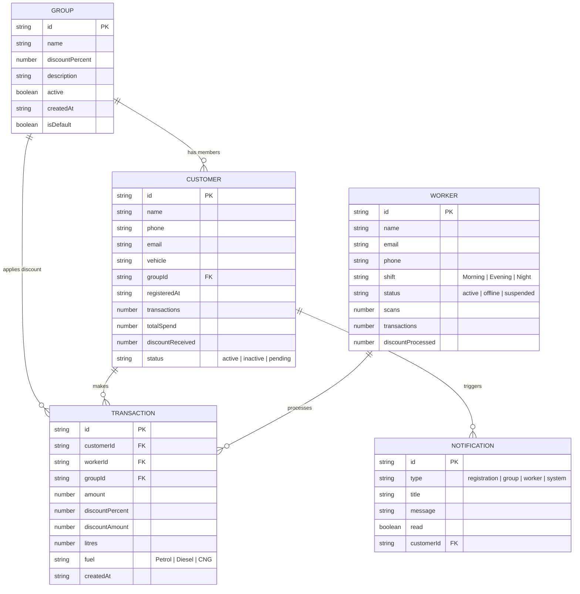
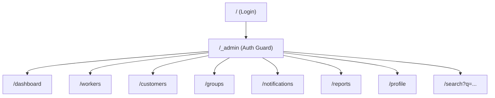
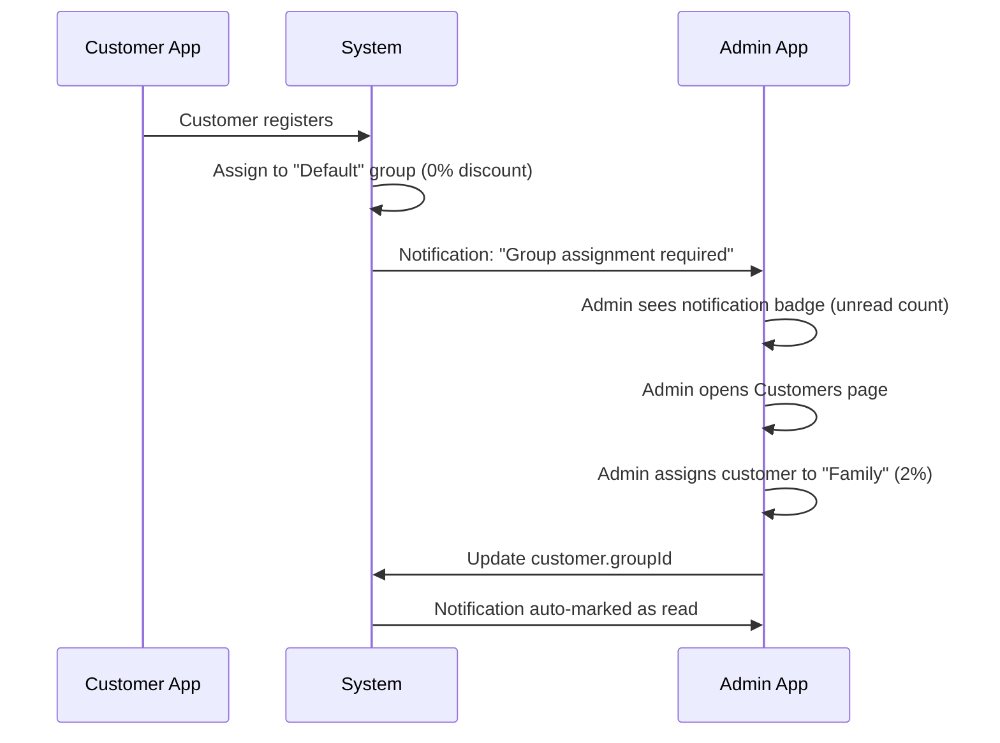
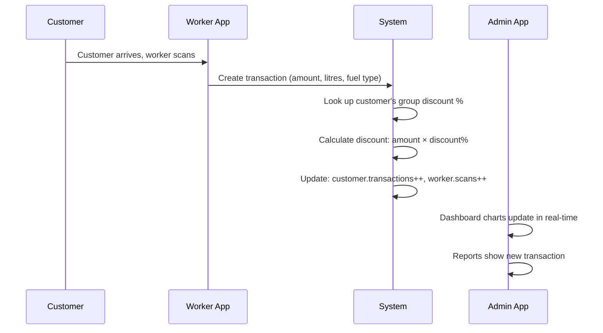

# FuelPoint Admin Console — Complete Project Documentation

---

## 1. What Is This Project?

**FuelPoint Admin Console** is a **premium admin dashboard web application** for managing a petrol-pump / fuel-station business. It gives the station owner (the "Admin") a single place to:

- **Manage Customers** — view every registered customer, see their transaction history, and assign them to discount groups.
- **Manage Workers** — track the staff who physically scan customers at the pump and process transactions.
- **Manage Discount Groups** — create groups like *Family*, *Friends*, *Employees*, each with their own discount percentage that is automatically applied when a customer fills fuel.
- **Monitor Activity** — real-time dashboard with charts for transactions, discounts given, registrations, and worker performance.
- **Receive Notifications** — alerts when a new customer registers and needs a group assignment.
- **Generate Reports** — date-range filtered reports for customers, workers, transactions, discounts, and groups, with CSV export.

> [!IMPORTANT]
> This is the **Admin App** — one of three apps in a larger system:
> | App | Who uses it | Purpose |
> |---|---|---|
> | **Customer App** | End customers | Register, view discounts, use the petrol pump |
> | **Worker App** | Pump attendants | Scan customers, process fuel transactions |
> | **Admin App** *(this project)* | Station owner / manager | Manage everything — customers, workers, groups, discounts, reports |

---

## 2. Why Was It Built?

The petrol-pump owner wants to offer **loyalty discounts** to different categories of people:

| Group | Discount | Who |
|---|---|---|
| Family | 2% | Owner's relatives |
| Friends | 1% | Personal contacts |
| Employees | 3% | Pump staff and partner businesses |
| Fleet Partners | 2.5% | Contracted logistics/taxi fleets |
| Default | 0% | New registrations (unassigned) |

When a customer registers via the Customer App, they land in the **Default / Unassigned** group with 0% discount. The admin then reviews and assigns them to the appropriate group. This project is the tool that makes that workflow — and all other administrative tasks — possible.

---

## 3. Technology Stack

| Layer | Technology | Why |
|---|---|---|
| **Language** | TypeScript | Type safety across the entire codebase |
| **UI Framework** | React 19 | Component-based UI rendering |
| **Meta-framework** | TanStack Start + TanStack Router | File-based routing with SSR capability (currently client-rendered) |
| **Build Tool** | Vite 8 | Fast dev server and optimized production builds |
| **Styling** | Tailwind CSS 4 | Utility-first CSS with custom design tokens |
| **UI Components** | Radix UI + shadcn/ui | Accessible, unstyled primitives wrapped in project styles |
| **Charts** | Recharts | Data visualization (area, bar, donut charts) |
| **State** | React Context (`useAdmin`) | Global client-side state for all admin data |
| **Forms** | React Hook Form + Zod | Form handling and validation |
| **Toast Notifications** | Sonner | Non-blocking user feedback |
| **Data Layer** | Mock data + service abstraction | Deterministic fake data, swappable for real APIs |
| **Icons** | Lucide React | Consistent, lightweight icon set |
| **Deployment Target** | Amazon Amplify / Cloudflare | Static SPA deployment |
| **Scaffolding** | Lovable.dev | Initial project generation |

---

## 4. Project Structure

```
FuelStationAdmin/
├── public/                        # Static assets (favicon, etc.)
├── src/
│   ├── components/
│   │   ├── admin/                 # Project-specific components
│   │   │   ├── AdminShell.tsx     # Main layout: sidebar + header + content area
│   │   │   ├── DataTable.tsx      # Reusable table with sorting, search, pagination
│   │   │   ├── charts.tsx         # TrendAreaChart, DonutChart, HorizontalBarChart
│   │   │   └── primitives.tsx     # PageHeader, StatCard, Panel, StatusBadge, GroupPill
│   │   └── ui/                    # 46 shadcn/ui components (button, dialog, select, etc.)
│   ├── hooks/
│   │   └── use-mobile.tsx         # Responsive breakpoint detection
│   ├── lib/
│   │   ├── admin-store.tsx        # React Context provider — ALL app state lives here
│   │   ├── utils.ts               # cn() utility for class merging
│   │   ├── error-capture.ts       # Error boundary utilities
│   │   ├── error-page.ts          # Error page rendering
│   │   └── lovable-error-reporting.ts  # Error reporting to Lovable platform
│   ├── routes/                    # File-based routes (TanStack Router)
│   │   ├── __root.tsx             # Root layout: HTML shell, providers, error/404 pages
│   │   ├── index.tsx              # Login page (route: /)
│   │   ├── _admin.tsx             # Auth guard layout — wraps all /dashboard, /workers, etc.
│   │   ├── _admin.dashboard.tsx   # Dashboard with analytics & charts
│   │   ├── _admin.workers.tsx     # Worker management (CRUD + detail view)
│   │   ├── _admin.customers.tsx   # Customer management (CRUD + group assignment)
│   │   ├── _admin.groups.tsx      # Discount group management
│   │   ├── _admin.notifications.tsx # Notification center
│   │   ├── _admin.reports.tsx     # Reports with date range + CSV export
│   │   ├── _admin.profile.tsx     # Admin profile & password change
│   │   └── _admin.search.tsx      # Global search results page
│   ├── services/
│   │   ├── types.ts               # TypeScript interfaces for all data models
│   │   ├── mockData.ts            # Deterministic mock data generator (96 customers, 10 workers, 420 transactions)
│   │   └── adminService.ts        # Single data-access layer + formatting helpers + analytics functions
│   ├── router.tsx                 # Router factory with QueryClient
│   ├── server.ts                  # SSR server entry point
│   ├── start.ts                   # TanStack Start config
│   ├── styles.css                 # Global design tokens, light/dark theme, custom utilities
│   └── routeTree.gen.ts           # Auto-generated route tree (do not edit)
├── package.json
├── vite.config.ts                 # Vite + TanStack Start + Tailwind config
├── tsconfig.json
├── components.json                # shadcn/ui configuration
└── README.md                      # Original project brief
```

---

## 5. Data Model

All type definitions live in [`types.ts`](file:///d:/Ran_project/FuelStationAdmin/src/services/types.ts):



---

## 6. How Authentication Works

> [!NOTE]
> Authentication is **mocked** on the client side. There is no real backend auth.

| Step | What happens |
|---|---|
| **1. Login page** (`/`) | Pre-filled with demo credentials: `rajesh.menon@fuelpoint.in` / `fuelpoint` |
| **2. Submit** | After a 600ms simulated delay, `login()` sets `authed = true` in the `AdminContext` and stores a session flag in `sessionStorage` |
| **3. Navigate** | Router redirects to `/dashboard` |
| **4. Route guard** | The [`_admin.tsx`](file:///d:/Ran_project/FuelStationAdmin/src/routes/_admin.tsx) layout checks `authReady && authed` — if false, it redirects back to `/` |
| **5. Remember me** | When checked, the session survives page refreshes (via `sessionStorage`) |
| **6. Logout** | Clears `sessionStorage`, sets `authed = false`, redirects to login |

---

## 7. State Management — The Admin Store

**All application state** is managed through a single React Context in [`admin-store.tsx`](file:///d:/Ran_project/FuelStationAdmin/src/lib/admin-store.tsx).

The `useAdmin()` hook provides:

| Property / Method | Type | Purpose |
|---|---|---|
| `authed`, `authReady` | `boolean` | Authentication state |
| `login(email, remember)` | Function | Sign in |
| `logout()` | Function | Sign out |
| `profile` | `AdminProfile` | Current admin's info |
| `updateProfile(patch)` | Function | Edit admin profile |
| `customers` | `Customer[]` | All customer records |
| `workers` | `Worker[]` | All worker records |
| `groups` | `Group[]` | All discount groups |
| `transactions` | `Transaction[]` | All fuel transactions |
| `notifications` | `Notification[]` | All notifications |
| `unreadCount` | `number` | Badge count for notifications |
| `assignCustomerGroup(id, groupId)` | Function | Move a customer to a different group |
| `saveGroup(group)` | Function | Create or update a group |
| `deleteGroup(groupId)` | Function | Delete group and move its customers to Default |
| `toggleGroupActive(groupId)` | Function | Enable/disable a group |
| `saveCustomer(customer)` | Function | Create or update a customer |
| `deleteCustomer(id)` | Function | Remove a customer |
| `saveWorker(worker)` | Function | Create or update a worker |
| `deleteWorker(id)` | Function | Remove a worker |
| `markRead(id)` | Function | Mark a notification as read |
| `markAllRead()` | Function | Mark all notifications as read |

---

## 8. Pages — Detailed Breakdown

### 8.1 Login (`/`)
[`index.tsx`](file:///d:/Ran_project/FuelStationAdmin/src/routes/index.tsx)

- Split-screen layout: brand panel (left) + form panel (right)
- Email + password fields with validation
- "Remember me" checkbox
- "Forgot password?" opens a dialog (mocked: shows a toast confirmation)

---

### 8.2 Dashboard (`/dashboard`)
[`_admin.dashboard.tsx`](file:///d:/Ran_project/FuelStationAdmin/src/routes/_admin.dashboard.tsx)

**Date range selector**: 7 / 30 / 90 days — all stats and charts react to this.

| Section | Content |
|---|---|
| **Stat Cards** (4) | Total Customers, Total Workers, Total Discount Given, Today's Transactions — each with trend arrows and clickable links |
| **Transactions Chart** | Area chart showing daily scan volume |
| **Group Distribution** | Donut chart of customers per discount group |
| **Discount Over Time** | Area chart of daily rupees discounted |
| **Worker Activity** | Horizontal bar chart of top workers by scans |
| **Recent Transactions** | Last 8 transactions with customer, fuel type, litres, amount, discount |

---

### 8.3 Workers (`/workers`)
[`_admin.workers.tsx`](file:///d:/Ran_project/FuelStationAdmin/src/routes/_admin.workers.tsx)

- **Stat Cards**: Total Workers, Active Workers, Total Scans, Discount Processed
- **Data Table**: Sortable, searchable, paginated — columns: Name, Shift, Status, Scans, Customers Scanned, Transactions, Discount Processed, Last Activity
- **CRUD**: Add / Edit / Delete workers via dialogs
- **Detail View**: Click a worker to see their full profile and activity stats
- **Worker Activity Chart**: Top performers bar chart

---

### 8.4 Customers (`/customers`)
[`_admin.customers.tsx`](file:///d:/Ran_project/FuelStationAdmin/src/routes/_admin.customers.tsx)

- **Stat Cards**: Total Customers, New Registrations, Active Customers, Used Pump
- **Data Table**: Sortable, searchable, filterable by group — columns: Name, Phone, Vehicle, Group, Transactions, Discount Received, Last Activity, Status
- **Group Assignment**: Select dropdown to move a customer between groups
- **CRUD**: Add / Edit / Delete customers via dialogs
- **Detail View**: Click a customer to see their full profile, group info, and transaction history
- **CSV Export**: Export customer data

---

### 8.5 Groups & Discounts (`/groups`)
[`_admin.groups.tsx`](file:///d:/Ran_project/FuelStationAdmin/src/routes/_admin.groups.tsx)

- **Stat Cards**: Total Active Groups, Total Customers in Groups, Total Discount Generated
- **Group Cards**: Each group shows name, discount %, customer count, total discount, status
- **CRUD**: Create / Edit / Delete groups via dialogs
- **Toggle Active/Inactive**: Deactivate a group without deleting it
- **Customer Assignment**: Bulk-assign customers from group management
- **Charts**: Group distribution donut + discount-per-group bar chart
- **Protection**: The "Default / Customer" group cannot be deleted or deactivated

---

### 8.6 Notifications (`/notifications`)
[`_admin.notifications.tsx`](file:///d:/Ran_project/FuelStationAdmin/src/routes/_admin.notifications.tsx)

- **Filters**: All, Unread, Registrations, System
- **Stat Cards**: Total Notifications, Unread Count
- **Notification List**: Each notification shows icon, title, message, timestamp, read/unread state
- **Key notification**: "New customer registration — group assignment required" with a link to the customer
- **Actions**: Mark individual as read, Mark All Read

---

### 8.7 Reports (`/reports`)
[`_admin.reports.tsx`](file:///d:/Ran_project/FuelStationAdmin/src/routes/_admin.reports.tsx)

- **Date Range Selector**: Today, This Week, This Month, 90 Days, Custom (with date pickers)
- **Report Tabs**: Customer Report, Worker Report, Transaction Report, Discount Report, Group Report
- **Each tab includes**: Summary stat cards + data table with relevant columns
- **CSV Export**: Each report type can be exported as a CSV file

---

### 8.8 My Profile (`/profile`)
[`_admin.profile.tsx`](file:///d:/Ran_project/FuelStationAdmin/src/routes/_admin.profile.tsx)

- **Profile Card**: Avatar (initials), name, role, email, phone, location, joined date
- **Edit Form**: Update name, email, phone, location
- **Change Password**: Current password, new password, confirm password (mocked)

---

### 8.9 Search (`/search?q=...`)
[`_admin.search.tsx`](file:///d:/Ran_project/FuelStationAdmin/src/routes/_admin.search.tsx)

- Global search from the header bar
- Searches across customers and workers by name, email, phone
- Results grouped by entity type

---

## 9. The Mock Data Layer — Designed for API Replacement

The project is specifically architected so **real APIs can replace mock data with zero UI changes**.

### How it works:

```
┌──────────────┐     ┌──────────────────┐     ┌──────────────┐
│   UI Pages   │────▶│  adminService.ts │────▶│  mockData.ts │
│   (routes)   │     │  (access layer)  │     │  (fake data) │
└──────────────┘     └──────────────────┘     └──────────────┘
                              │
                              ▼  (future)
                     ┌──────────────────┐
                     │   REST API /     │
                     │   GraphQL        │
                     └──────────────────┘
```

**To connect real APIs**, you only need to change [`adminService.ts`](file:///d:/Ran_project/FuelStationAdmin/src/services/adminService.ts):

```typescript
// Current (mock):
getCustomers: (): Customer[] => mockCustomers,

// Future (real API):
getCustomers: async (): Promise<Customer[]> => {
  const res = await fetch('/api/customers');
  return res.json();
},
```

### Mock data characteristics:
- **96 customers** with realistic Indian names, phones, vehicles
- **10 workers** across Morning/Evening/Night shifts
- **420 transactions** spanning 90 days
- **6 discount groups** (including 1 inactive seasonal group)
- **9 notifications** (6 registration alerts + 3 system/worker/group alerts)
- **Deterministic**: Uses a seeded PRNG so data is identical across page loads and server/client renders

---

## 10. Reusable Component System

### Admin Components ([`src/components/admin/`](file:///d:/Ran_project/FuelStationAdmin/src/components/admin))

| Component | File | Purpose |
|---|---|---|
| `AdminShell` | [`AdminShell.tsx`](file:///d:/Ran_project/FuelStationAdmin/src/components/admin/AdminShell.tsx) | Full page layout with collapsible sidebar, header with search/notifications/profile, dark mode toggle |
| `DataTable` | [`DataTable.tsx`](file:///d:/Ran_project/FuelStationAdmin/src/components/admin/DataTable.tsx) | Generic table with column definitions, sorting, filtering, pagination |
| `PageHeader` | [`primitives.tsx`](file:///d:/Ran_project/FuelStationAdmin/src/components/admin/primitives.tsx) | Consistent page title + subtitle + action buttons |
| `StatCard` | [`primitives.tsx`](file:///d:/Ran_project/FuelStationAdmin/src/components/admin/primitives.tsx) | KPI card with icon, value, trend delta, clickable link |
| `Panel` | [`primitives.tsx`](file:///d:/Ran_project/FuelStationAdmin/src/components/admin/primitives.tsx) | Card wrapper for content sections |
| `StatusBadge` | [`primitives.tsx`](file:///d:/Ran_project/FuelStationAdmin/src/components/admin/primitives.tsx) | Colored badge for active/inactive/pending/offline/suspended status |
| `GroupPill` | [`primitives.tsx`](file:///d:/Ran_project/FuelStationAdmin/src/components/admin/primitives.tsx) | Colored pill showing group name + discount % |
| `TrendAreaChart` | [`charts.tsx`](file:///d:/Ran_project/FuelStationAdmin/src/components/admin/charts.tsx) | Responsive area chart with tooltip |
| `DonutChart` | [`charts.tsx`](file:///d:/Ran_project/FuelStationAdmin/src/components/admin/charts.tsx) | Donut/pie chart with labels |
| `HorizontalBarChart` | [`charts.tsx`](file:///d:/Ran_project/FuelStationAdmin/src/components/admin/charts.tsx) | Horizontal bar chart for rankings |

### UI Components ([`src/components/ui/`](file:///d:/Ran_project/FuelStationAdmin/src/components/ui))

46 shadcn/ui components including: Button, Dialog, AlertDialog, Select, Input, Label, Table, Tabs, Badge, Card, Popover, DropdownMenu, Checkbox, Separator, Sheet, Sidebar, Tooltip, Calendar, and more.

---

## 11. Design System

### Color Palette

| Token | Light | Dark | Usage |
|---|---|---|---|
| `--primary` | `#0B4C8C` | `#249ADF` | Primary buttons, links, active states |
| `--navy` | `#062A4D` | — | Sidebar background, login panel |
| `--teal` | `#F26B21` | `#FF8A3D` | Accent/orange highlights, discount indicators |
| `--background` | `#F7F9FC` | `#081C30` | Page background |
| `--card` | `#FFFFFF` | `#0D2A45` | Card surfaces |
| `--destructive` | `#DC3E3E` | `#F16565` | Delete actions, error states |
| `--success` | `#1FA971` | — | Active status badges |
| `--warning` | `#F5A623` | — | Warning badges |

### Typography
- **Font**: Lato (Google Fonts) with system-ui fallback
- **Tight letter-spacing** on headings (-0.02em)
- **Anti-aliased** rendering

### Theme
- **Light mode** is the default
- **Dark mode** toggle in the header (persisted in `localStorage`)
- Theme class (`dark`) is toggled on `<html>` element

---

## 12. Routing Architecture



- **`/`** — Public login page. If already authenticated, user can navigate away.
- **`/_admin`** — Layout route (not a visible page). Checks authentication, wraps children in `AdminShell`.
- **`/_admin/*`** — All admin pages. Unauthenticated users are redirected to `/`.

---

## 13. Key Business Flows

### Flow 1: New Customer Registration → Group Assignment



### Flow 2: Fuel Transaction



---

## 14. How to Run the Project

### Prerequisites
- **Node.js** ≥ 18 (or Bun)
- **npm** (comes with Node) or **bun**

### Development

```bash
# Clone the repository
git clone <repository-url>
cd FuelStationAdmin

# Install dependencies
npm install
# or: bun install

# Start dev server
npm run dev
# Opens at http://localhost:5173 (or next available port)
```

### Production Build

```bash
npm run build
npm run preview   # Preview the production build locally
```

### Available Scripts

| Script | Command | Purpose |
|---|---|---|
| `dev` | `vite dev` | Start development server with HMR |
| `build` | `vite build` | Production build |
| `build:dev` | `vite build --mode development` | Development build (unminified) |
| `preview` | `vite preview` | Preview production build |
| `lint` | `eslint .` | Run linter |
| `format` | `prettier --write .` | Format all files |

---

## 15. How to Extend This Project

### Adding a New Page

1. Create a new file in `src/routes/` following the naming convention:
   - `_admin.pagename.tsx` — for authenticated admin pages
2. The route is **auto-registered** by TanStack Router's file-based routing
3. Add a navigation link in [`AdminShell.tsx`](file:///d:/Ran_project/FuelStationAdmin/src/components/admin/AdminShell.tsx) `nav` array
4. Run `npm run dev` — the route tree regenerates automatically

### Connecting Real APIs

1. Replace function bodies in [`adminService.ts`](file:///d:/Ran_project/FuelStationAdmin/src/services/adminService.ts) with `fetch()` calls
2. Convert functions to `async` and update the `AdminProvider` to use `useEffect` or TanStack Query for data fetching
3. Remove the `mockData.ts` import once all endpoints are connected
4. The type interfaces in [`types.ts`](file:///d:/Ran_project/FuelStationAdmin/src/services/types.ts) serve as the API contract

### Adding a New Data Entity

1. Define the TypeScript interface in [`types.ts`](file:///d:/Ran_project/FuelStationAdmin/src/services/types.ts)
2. Add mock data in [`mockData.ts`](file:///d:/Ran_project/FuelStationAdmin/src/services/mockData.ts)
3. Add getter function in [`adminService.ts`](file:///d:/Ran_project/FuelStationAdmin/src/services/adminService.ts)
4. Add state + CRUD methods in [`admin-store.tsx`](file:///d:/Ran_project/FuelStationAdmin/src/lib/admin-store.tsx)
5. Create the page route in `src/routes/`

---

## 16. Summary

| Aspect | Details |
|---|---|
| **What** | Admin dashboard for a petrol pump discount management system |
| **Why** | Enables the station owner to manage customers, workers, discount groups, and track all financial activity |
| **For Whom** | Petrol pump owner / super admin |
| **Current State** | Fully functional frontend with mock data — ready for real API integration |
| **Deployment** | Static SPA, deployable to Amazon Amplify, Cloudflare, Vercel, or any static host |
| **Key Feature** | Discount group system — customers get automatic discounts based on their assigned group |
| **Scale** | Handles 96 customers, 10 workers, 420 transactions in mock data; designed for real-world scale |
